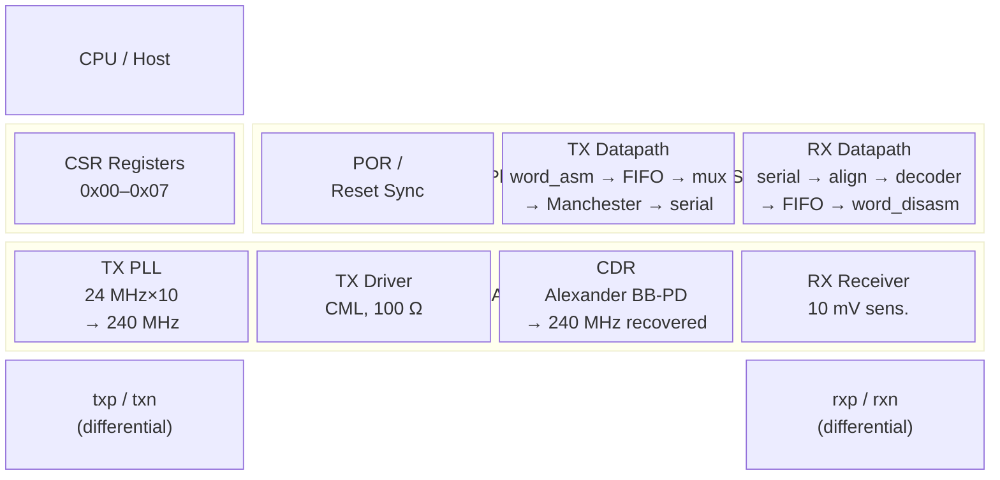

# SERDESPHY — SKY130 Serial Transceiver PHY
## Implementation Specification  v0.1

| Field | Value |
|---|---|
| Document | `docs/spec.md` |
| Status | **Normative** — supersedes `docs/info.md` where they conflict |
| RTL baseline | git HEAD at time of writing; all fixes in `docs/implementation-draft/00-fixes-applied.md` incorporated |
| Author | Ray Bello |
| Date | 2025 |

---

## 1. Purpose and Scope

This document is the ground-truth specification for the SERDESPHY IP.  It describes
**exactly what is implemented** in `src/`, reconciling the original datasheet draft
(`docs/info.md`) against the implementation audit (`docs/implementation-draft/
01-spec-vs-implementation.md`) and the applied fixes (`00-fixes-applied.md`).

Where the original datasheet was aspirational or inaccurate, this spec states the
corrected intent.  Where the RTL intentionally uses a behavioral shortcut (e.g.
the CDR clock alias), this spec documents that shortcut and gates the real
requirement behind an explicit TODO.

**End-goal framing.**  The long-term target is a USB-FS (12 Mbps) / USB-HS
(480 Mbps) PHY driven from a CPU over a Wishbone bus.  The current device is an
intermediate step: a Manchester-encoded 240 Mbps SerDes PHY with an I²C register
interface.  Section 15 maps the delta from here to USB.

---

## 2. Architecture Overview



### 2.1 Top-Level Instance Tree

```
tt_um_raybello_serdesphy_top  (src/project.v)          ← TinyTapeout pin map
 └─ serdesphy_top             (src/serdesphy_top.v)
     ├─ serdesphy_pcs         (src/digital/serdesphy_pcs.v)
     │   ├─ serdesphy_por
     │   ├─ serdesphy_reset_synchronizer
     │   ├─ serdesphy_pll_ctrl
     │   ├─ serdesphy_csr_top
     │   │   ├─ serdesphy_i2c_slave
     │   │   │   ├─ serdesphy_registerInterface
     │   │   │   └─ serdesphy_serialInterface
     │   │   └─ (debug_mux — orphaned, not instantiated)
     │   ├─ serdesphy_tx_top
     │   │   ├─ serdesphy_word_assembler
     │   │   ├─ serdesphy_tx_fifo
     │   │   ├─ serdesphy_prbs_generator
     │   │   ├─ serdesphy_tx_data_mux
     │   │   └─ serdesphy_manchester_encoder
     │   └─ serdesphy_rx_top
     │       ├─ serdesphy_manchester_decoder
     │       ├─ serdesphy_rx_fifo          ← CDC boundary
     │       ├─ serdesphy_word_disassembler
     │       └─ serdesphy_prbs_checker
     ├─ serdesphy_deserializer_if           ← CDC sequencing (RX side)
     └─ serdesphy_pma          (src/analog/serdesphy_pma.v)
         ├─ serdesphy_ana_pll  (+ sub-blocks: PFD, CP, LPF, VCO, divider)
         ├─ serdesphy_ana_tx_differential_driver
         ├─ serdesphy_ana_loopback_switch
         ├─ serdesphy_ana_rx_differential_receiver
         ├─ serdesphy_ana_cdr
         └─ serdesphy_ana_cdr_vco
```

**Orphaned modules (written, never instantiated):**  `serdesphy_pll_ctrl.v` is now
instantiated (post-fix).  Still orphaned: `serdesphy_debug_mux.v`,
`serdesphy_ana_analog_debug_buffer.v`, `serdesphy_serializer_if.v`
(superseded by inline 240 MHz shift register in `tx_top`),
`serdesphy_ana_serializer.v`, `serdesphy_ana_deserializer.v`,
`serdesphy_ana_bias_generator.v`, `serdesphy_ana_clk_enable.v`.

---

## 3. Clock Domains

| Domain | Source | Nominal Frequency | Used by |
|---|---|---|---|
| `clk_24m` | External `clk_ref_24m` pin | 24 MHz | CSR, POR, TX FIFO (write), word assembler, TX FSM, RX FIFO (read), word disassembler, RX controller FSM, PLL ctrl |
| `clk_240m_tx` | PLL VCO ÷ 1 output | 240 MHz | Serial shift register in `tx_top` |
| `clk_240m_rx` | CDR VCO output | 240 MHz ± CDR ppm | Manchester decoder, RX alignment FSM, RX FIFO (write), PRBS checker |

**CDR behavioral shortcut.**  In the current implementation,
`clk_240m_rx = clk_240m_pll` (PMA assigns `clk_240m_cdr = pll_clk_240m`).
The RX FIFO is a proper gray-code dual-clock FIFO and will exercise real CDC
once the CDR VCO is real.  See Section 14.

**Clock enables:**

| Enable | Condition | Effect |
|---|---|---|
| `clk_24m_en` | Always `1'b1` | Reference always live |
| `clk_240m_tx_en` | `pll_lock_raw` | TX serial shifter gated |
| `clk_240m_rx_en` | `deserializer_lock` | RX serial accumulator gated |

---

## 4. Reset Architecture

All resets are **synchronous** within their respective clock domains.  The
active level is compared against parameter `RS_LV` (default `0`, meaning
active-low).

### 4.1 Reset Sources

| Signal | Polarity | Generation |
|---|---|---|
| `rst_n` (top) | Active-low | External pin `RST_N` |
| `rst_n_24m` | Active-low | `serdesphy_reset_synchronizer`, synchronized to `clk_24m` |
| `rst_n_240m_tx` | Active-low | `serdesphy_reset_synchronizer`, synchronized to `clk_240m_tx` |
| `rst_n_240m_rx` | Active-low | `serdesphy_reset_synchronizer`, synchronized to `clk_240m_rx` |

### 4.2 Power-On-Reset Sequence

The POR module (`serdesphy_por`) adds supply-aware sequencing on top of the
external reset:

```
STATE_RESET → STATE_WAIT_SUPPLY (dvdd_ok & avdd_ok & ~rst_n_in)
           → STATE_SEQUENCING (48 cycles supply debounce @ 24 MHz ≈ 2 µs)
              └── SEQ_RELEASE_ISO     (de-assert analog_iso_n)
              └── SEQ_RELEASE_DIGITAL (12 cycles → de-assert digital_reset_n)
              └── SEQ_RELEASE_ANALOG  (12 cycles → de-assert analog_reset_n)
              └── SEQ_DONE
           → STATE_READY
```

| Output | Asserted (active) when |
|---|---|
| `analog_iso_n` | Low → analog blocks isolated |
| `digital_reset_n` | Low → digital in reset |
| `analog_reset_n` | Low → analog in reset |
| `power_good` | High → both supplies OK |
| `por_active` | High → POR sequence running |
| `por_complete` | High → POR done, system operational |

Timing constants (all at 24 MHz):

| Constant | Value | Time |
|---|---|---|
| `SUPPLY_STABLE_CYCLES` | 48 | ≈ 2 µs |
| `RESET_HOLD_CYCLES` | 24 | ≈ 1 µs |
| `RELEASE_DELAY_CYCLES` | 12 | ≈ 0.5 µs between release stages |

---

## 5. Top-Level Interface (`serdesphy_top`)

### 5.1 Clocks and Reset

| Port | Dir | Width | Description |
|---|---|---|---|
| `clk_ref_24m` | I | 1 | 24 MHz ±2% reference clock, CMOS 50% duty |
| `rst_n` | I | 1 | Asynchronous active-low reset; must be de-asserted synchronously to `clk_ref_24m` after power-up |

### 5.2 CSR Interface (I²C, split for Tiny Tapeout)

| Port | Dir | Width | Description |
|---|---|---|---|
| `sda_in` | I | 1 | I²C SDA input from IO pad |
| `sda_out` | O | 1 | I²C SDA output to IO pad |
| `sda_oe` | O | 1 | SDA output enable, active-high |
| `scl` | I | 1 | I²C SCL clock, ≤ 24 MHz |

### 5.3 Transmit Interface

| Port | Dir | Width | Description |
|---|---|---|---|
| `tx_data[3:0]` | I | 4 | Parallel transmit nibble |
| `tx_valid` | I | 1 | Strobe: `tx_data` valid this cycle; gated internally by `tx_en && tx_fifo_en` |
| `txp` | O | 1 | Differential TX positive (CML, 100 Ω load) |
| `txn` | O | 1 | Differential TX negative |

### 5.4 Receive Interface

| Port | Dir | Width | Description |
|---|---|---|---|
| `rxp` | I | 1 | Differential RX positive |
| `rxn` | I | 1 | Differential RX negative |
| `rx_data[3:0]` | O | 4 | Parallel receive nibble |
| `rx_valid` | O | 1 | Strobe: `rx_data` valid this cycle |

### 5.5 Status Outputs

| Port | Dir | Width | Description |
|---|---|---|---|
| `pll_lock` | O | 1 | PLL frequency locked (see §9.1 for qualification logic) |
| `cdr_lock` | O | 1 | CDR phase locked |
| `prbs_err` | O | 1 | PRBS error detected (combinational, from `prbs_checker`) |
| `tx_active` | O | 1 | TX datapath actively transmitting |
| `tx_error` | O | 1 | TX error latch (sticky; cleared by de-asserting `tx_en`) |
| `rx_active` | O | 1 | RX datapath receiving data |
| `rx_error` | O | 1 | RX error latch |
| `rx_aligned` | O | 1 | Manchester word alignment achieved |
| `phy_ready` | O | 1 | POR complete, PLL locked, system ready |

### 5.6 Miscellaneous

| Port | Dir | Width | Description |
|---|---|---|---|
| `test_mode` | I | 1 | Test / loopback mode; bypasses deserializer (TX serial looped back into RX accumulator) |
| `lpbk_en` | I | 1 | Analog loopback enable (routes TXP/TXN → RXP/RXN inside PMA) |
| `dbg_ana` | O | 1 | Analog debug output; driven by `DEBUG_ENABLE[2:0]` via `serdesphy_csr_top` |
| `dvdd_ok` | I | 1 | 1.8 V digital supply monitor |
| `avdd_ok` | I | 1 | 3.3 V analog supply monitor |

---

## 6. Transmit Datapath

### 6.1 Signal Flow

```
tx_data[3:0] + tx_valid (CLK_24M)
      │
      ▼
[word_assembler]  2 × 4-bit → 8-bit over 2 cycles
      │  word_assembler_out[7:0] / word_assembler_valid
      ▼
[tx_fifo]  8-deep × 8-bit FIFO, CLK_24M
      │  tx_fifo_data_out[7:0] / fifo_read_valid
      ▼
[tx_data_mux]  select FIFO | PRBS | IDLE
      │  tx_mux_data_out[7:0] / tx_mux_data_valid
      ▼
[manchester_encoder]  8-bit → 16-bit biphase (CLK_24M)
      │  manchester_encoder_out[15:0] / manchester_encoder_valid
      ▼
[16-bit shift register in tx_top]  CLK_240M_TX  (MSB-first, 15 ns/bit)
      │  tx_serial_data / tx_serial_valid
      ▼
[analog PMA: serializer → differential driver]
      │
txp / txn
```

### 6.2 Word Assembler (`serdesphy_word_assembler`)

| Parameter | Value |
|---|---|
| Input | 4-bit nibble DDR: low nibble at rising edge, high nibble at falling edge of `clk_24m` |
| Valid | `tx_valid` — rising-edge strobe; one assertion = one DDR pair (8 bits) |
| Output | 8-bit word `{fall_nibble, rise_nibble}`, `tx_word_valid` pulse |
| Latency | 1 `clk_24m` cycle from `tx_valid` to `tx_word_valid` |
| Throughput | 1 word per `clk_24m` cycle (8 bits × 24 MHz = 192 Mbps effective input rate) |
| `tx_word_ready` | Permanently `1` — always ready for the next DDR pair |
| Enable | `tx_en && tx_fifo_en` gating applied to `tx_valid` before the assembler |

**Implementation:** negedge FF captures the falling-edge nibble; posedge FF re-synchronises it and registers the rising-edge nibble on the same cycle; `tx_word_valid` asserts one posedge later.

### 6.3 TX FIFO (`serdesphy_tx_fifo`)

| Parameter | Value |
|---|---|
| Depth | 8 words |
| Width (internal) | 8 bits |
| Write clock | `clk_24m` |
| Read clock | `clk_24m` (single-clock FIFO; binary pointer) |
| Write enable | `tx_en && tx_fifo_en` |
| `full` threshold | 8/8 (true full; the "7 words" in `info.md` §4.2 is a documentation artifact — no early-warning flag is implemented) |
| Overflow action | Set `tx_overflow` sticky; discard data |
| Underflow action | Set `tx_underflow` sticky |
| Sticky clear | `status_read_clear` pulse (I²C read of STATUS 0x06) |

### 6.4 PRBS Generator (`serdesphy_prbs_generator`)

| Parameter | Value |
|---|---|
| Polynomial | x⁷ + x⁶ + 1 |
| Output width | 8 bits parallel |
| Update rate | One 8-bit word per `clk_24m` cycle while enabled |
| Enable | `tx_en && tx_prbs_en` |
| LFSR taps | Verified to match `serdesphy_prbs_checker.v`'s unrolled LFSR |

### 6.5 TX Data Mux (`serdesphy_tx_data_mux`)

Priority (highest first):

1. `tx_idle` asserted → drive zeros, `mux_valid = 0`
2. `tx_data_sel == 0` → PRBS data
3. `tx_data_sel == 1` → FIFO data

**Constraint:** `tx_data_sel` must not change while `tx_en = 1` (undefined TX output).

### 6.6 Manchester Encoder (`serdesphy_manchester_encoder`)

Encoding (IEEE 802.3 convention):

| Data bit | Manchester symbol |
|---|---|
| `0` | `10` (High-to-Low at bit center) |
| `1` | `01` (Low-to-High at bit center) |

| Parameter | Value |
|---|---|
| Input | 8-bit parallel, `data_valid` strobe |
| Output | 16-bit biphase word, `manchester_valid` pulse |
| Clock | `clk_24m` |
| Latency | 1 clock cycle from `data_valid` to `manchester_valid` |

### 6.7 Serializer (inside `serdesphy_tx_top`, 240 MHz domain)

```
On manchester_encoder_valid && serial_bit_count == 0:
  Load manchester_encoder_out[15:0] into shift register
  Output MSB immediately; pre-shift remaining 15 bits
  serial_bit_count ← 15

Each subsequent clk_240m_tx cycle (while serial_bit_count > 0):
  Shift left; output serial_shift_reg[15]
  serial_bit_count ← serial_bit_count - 1

When serial_bit_count == 0 and no new word:
  tx_serial_data ← 0, tx_serial_valid ← 0 (idle line)
```

**Timing:** 16 bits × (1 / 240 MHz) = 66.7 ns per 8-bit data word.  Effective
data rate = 8 bits × 24 MHz = 192 Mbps (not 240 Mbps; Manchester doubles the
symbol count).

### 6.8 TX Controller FSM

States (binary encoded, 3 bits):

| State | Encoding | Description |
|---|---|---|
| `TX_STATE_DISABLED` | `3'b000` | `tx_en` de-asserted or PLL not locked |
| `TX_STATE_IDLE` | `3'b001` | Enabled, waiting for data or forced idle |
| `TX_STATE_STARTING` | `3'b010` | First word entering Manchester encoder |
| `TX_STATE_ACTIVE` | `3'b011` | Serializing words |
| `TX_STATE_STOPPING` | `3'b100` | Draining Manchester encoder before disable |
| `TX_STATE_ERROR` | `3'b101` | Error latch; cleared by de-asserting `tx_en` |

Transition table:

| From | Condition | To |
|---|---|---|
| `DISABLED` | `tx_en && clk_240m_tx_en` | `IDLE` |
| `IDLE` | `!tx_en \|\| !clk_240m_tx_en` | `DISABLED` |
| `IDLE` | `(tx_fifo_en && word_assembler_valid) \|\| (tx_prbs_en && prbs_data_valid)` | `STARTING` |
| `STARTING` | `manchester_encoder_valid` | `ACTIVE` |
| `ACTIVE` | `!tx_en \|\| !clk_240m_tx_en` | `STOPPING` |
| `ACTIVE` | `tx_idle` | `IDLE` |
| `ACTIVE` | error repeated ≥ 8 times | `ERROR` |
| `STOPPING` | `!manchester_encoder_valid` | `DISABLED` |
| `ERROR` | `!tx_en` | `DISABLED` |
| any | illegal encoding | `ERROR` |

Error counter: 3-bit saturating.  Increments on `manchester_encoder_error ||
tx_fifo_underflow`.  Enters `ERROR` at count 7.

---

## 7. Receive Datapath

### 7.1 Signal Flow

```
rxp / rxn (differential)
      │
[analog PMA: RX receiver + CDR → deserializer]
      │  deserializer_data (1-bit serial, CLK_240M_RX)
      ▼
[serdesphy_deserializer_if]  CDC sequencing + TEST_MODE bypass
      │  rx_serial_data / rx_serial_valid / rx_serial_error  (→ CLK_24M side)
      ▼
[16-bit sliding window accumulator in rx_top]  CLK_240M_RX
      │  manchester_word_reg[15:0] / manchester_word_valid (pre-validated)
      ▼
[manchester_decoder + alignment FSM]  CLK_240M_RX
      │  decoded_data[7:0] / decode_valid / decode_error
      ▼
[rx_fifo (dual-clock gray-code)]  wr_clk=CLK_240M_RX → rd_clk=CLK_24M
      │  rx_fifo_data_out[7:0] / rx_fifo_rd_valid
      ▼
[word_disassembler]  8-bit → 2 × 4-bit over 2 cycles (CLK_24M)
      │  rx_data[3:0] / rx_valid
      ▼
External host
```

### 7.2 Serial Accumulator and Manchester Alignment

The RX path uses a **sliding 16-bit window** on every `clk_240m_rx` cycle:

```
On each clk_240m_rx cycle (when clk_240m_rx_en && rx_en):
  If rx_serial_valid && !rx_serial_error:
    serial_shift_reg ← {serial_shift_reg[14:0], rx_serial_data}
    If valid_manchester_word(serial_shift_reg):
      manchester_word_reg   ← serial_shift_reg
      manchester_word_valid ← 1  (one-cycle pulse)
    Else:
      manchester_word_valid ← 0
```

`valid_manchester_word()`: all eight 2-bit symbol pairs must be `01` or `10`
(never `00` or `11`).

**Why sliding window works:** Idle gaps between words carry drive-low zeros,
which produce all-`00` symbols — reliably invalid Manchester — so a partially-
overlapping window spanning a word boundary fails the check until it is
entirely within one valid word.  No fixed-stride "skip 16" is needed.

**Alignment FSM** (clocked by `clk_240m_rx`):

| State | Description |
|---|---|
| `ALIGN_STATE_SEARCH` | Waiting for first valid Manchester window |
| `ALIGN_STATE_LOCKED` | Aligned; counting idle cycles since last good word |

| Transition | Condition |
|---|---|
| `SEARCH → LOCKED` | `manchester_word_valid` pulse observed |
| `LOCKED → SEARCH` | `no_valid_word_count` reaches `NO_VALID_WORD_TIMEOUT = 1000` cycles (≈ 4.17 µs @ 240 MHz) |

Reset: `rx_align_rst`, `rx_state == DISABLED`, or `rx_state == ERROR`.

### 7.3 Manchester Decoder (`serdesphy_manchester_decoder`)

Decodes `01` → `1`, `10` → `0`.  Sets `decode_error` when any 2-bit symbol is
`00` or `11`.  Clocked by `clk_240m_rx`.

| Parameter | Value |
|---|---|
| Input | 16-bit Manchester word (pre-validated by accumulator) |
| Output | 8-bit decoded data + `decode_valid` + `decode_error` |
| Clock | `clk_240m_rx` |

### 7.4 RX FIFO — CDC Boundary (`serdesphy_rx_fifo`)

This is the only true clock-domain crossing in the RX path.

| Parameter | Value |
|---|---|
| Depth | 8 words |
| Width | 8 bits |
| Write clock | `clk_240m_rx` |
| Read clock | `clk_24m` |
| Pointer synchronization | Gray-code, 2-flop synchronizer |
| Write enable | `rx_en && rx_fifo_en` |
| Write valid | `manchester_decoder_valid && !manchester_decoder_error` (error frames excluded) |
| Read enable | `word_disassembler_ready` |
| Overflow / underflow | Sticky; cleared by `status_read_clear` |

**Behavioral note:** Until the CDR VCO is real (`clk_240m_rx = clk_240m_tx`),
this FIFO operates as a single-clock FIFO.  The gray-code logic is correct and
will work correctly once the two clocks become independent.

### 7.5 Word Disassembler (`serdesphy_word_disassembler`)

Inverse of word assembler: outputs both nibbles within a single `clk_24m` cycle using DDR drive.

| Parameter | Value |
|---|---|
| Input | 8-bit word, `rx_word_valid` |
| Output (rising edge) | `rx_data_nibble[3:0]` = `word[3:0]` (low nibble) |
| Output (falling edge) | `rx_data_nibble[3:0]` = `word[7:4]` (high nibble) |
| `rx_valid` | Rising-edge pulse one cycle after `rx_word_valid`; host must capture both edges |
| Latency | 1 `clk_24m` cycle from `rx_word_valid` to `rx_valid` |
| Throughput | 1 word per `clk_24m` cycle (192 Mbps effective output rate) |
| `rx_word_ready` | Permanently `1` |
| Clock | `clk_24m` |

**Implementation:** posedge FF registers `word[3:0]` for the rising-phase drive; negedge FF registers `word[7:4]` for the falling-phase drive; `rx_data_nibble = clk ? nibble_rise : nibble_fall`.

### 7.6 PRBS Checker (`serdesphy_prbs_checker`)

Clocked by `clk_240m_rx` (same fast domain as the decoder it reads from).

| Parameter | Value |
|---|---|
| Polynomial | x⁷ + x⁶ + 1 (matches TX generator) |
| Input | `manchester_decoder_out[7:0]`, `manchester_decoder_valid` |
| Error output | `prbs_error` (combinational pulse), `error_count[7:0]` (saturating at 255) |
| Counter reset | `rx_align_rst` (clears both alignment and error count) |
| Sticky error | `sticky_error_reg`; cleared by `clear_sticky` (= `status_read_clear`) |

### 7.7 RX Data Output Mux

Controlled by `rx_data_sel` (CSR DATA_SELECT[1]):

| `rx_data_sel` | `rx_data[3:0]` | `rx_valid` |
|---|---|---|
| `0` | `word_disassembler_out[3:0]` | `word_disassembler_valid` |
| `1` | `prbs_error_count[3:0]` (lower nibble) | `manchester_decoder_valid` |

### 7.8 RX Controller FSM

States (binary encoded, 3 bits):

| State | Encoding | Description |
|---|---|---|
| `RX_STATE_DISABLED` | `3'b000` | `rx_en` de-asserted |
| `RX_STATE_ALIGNING` | `3'b001` | Waiting for Manchester alignment |
| `RX_STATE_ACQUIRING` | `3'b010` | Alignment achieved, waiting for first decoded word |
| `RX_STATE_ACTIVE` | `3'b011` | Receiving data |
| `RX_STATE_ERROR` | `3'b100` | Error latch |

Transition table (clocked by `clk_24m`):

| From | Condition | To |
|---|---|---|
| `DISABLED` | `rx_en && clk_240m_rx_en` | `ALIGNING` |
| `ALIGNING` | `!rx_en \|\| !clk_240m_rx_en` | `DISABLED` |
| `ALIGNING` | `rx_aligned_reg` asserted | `ACQUIRING` |
| `ACQUIRING` | `!rx_en \|\| !clk_240m_rx_en` | `DISABLED` |
| `ACQUIRING` | `manchester_data_valid` | `ACTIVE` |
| `ACTIVE` | `!rx_en \|\| !clk_240m_rx_en` | `DISABLED` |
| `ACTIVE` | `!rx_aligned_reg` | `ALIGNING` |
| `ACTIVE` | error repeated ≥ 8 times | `ERROR` |
| `ERROR` | `!rx_en` | `DISABLED` |
| any | illegal encoding | `ERROR` |

Error sources counted toward `error_count`: `manchester_decoder_error`,
`rx_fifo_overflow_wire`, `rx_serial_error`, `prbs_error_wire`.

---

## 8. Physical Medium Attachment (PMA)

All PMA sub-blocks are **behavioral models** implemented as synthesizable Verilog
placeholders.  No SPICE, schematic, or layout exists.  See Section 14 for limits.

### 8.1 Transmit PLL (`serdesphy_ana_pll`)

| Parameter | Specification | Behavioral model |
|---|---|---|
| Reference frequency | 24 MHz ± 2% | Fixed; VCO ignores `vco_control` |
| Multiplication ratio | 10 | ÷10 feedback divider present |
| VCO output | 240 MHz nominal | Fixed 240 MHz toggle regardless of `vco_trim` |
| Lock time | 8–10 µs typ/max | Counter: 240 cycles @ 24 MHz → `pll_lock_raw` |
| Jitter | 50–100 ps RMS | Not modeled |
| VCO tuning range | 200–400 MHz | Not modeled; `vco_trim` has no effect |
| Charge pump | 10–80 µA (4 settings) | Tied to `1'b0` output ("placeholder") |

**PLL Lock Controller (`serdesphy_pll_ctrl`).**  Implements hysteresis on
`pll_lock_raw`:

| Parameter | Value |
|---|---|
| `LOCK_COUNT_MAX` | 4 cycles (≈ 167 ns additional debounce) |
| `UNLOCK_COUNT` | 240 cycles (10 µs before `pll_lock` de-asserts) |

States: `LOCK_STATE_UNLOCKED → LOCK_STATE_ACQUIRING → LOCK_STATE_LOCKED`.

`pll_lock` is a function of `phy_en + pll_lock_raw + pll_vco_ok + pll_cp_ok`
only.  It is **independent of `tx_en`** (this was bug 2.1 in the audit; fixed).

### 8.2 TX Differential Driver (`serdesphy_ana_tx_differential_driver`)

Behavioral: digital `txp = tx_serial_data`, `txn = ~tx_serial_data`.  No
swing/impedance/pre-emphasis modeling.  Target: 400–800 mVpp differential into
100 Ω.

### 8.3 RX Differential Receiver (`serdesphy_ana_rx_differential_receiver`)

Behavioral: `rx_data_out = rxp > rxn` (limiting digital comparator).  No
sensitivity/hysteresis/offset modeling.  Target: 10 mV minimum sensitivity.

### 8.4 Clock/Data Recovery (`serdesphy_ana_cdr`, `serdesphy_ana_cdr_vco`)

Behavioral implementation of the Alexander bang-bang phase detector:

- Samples incoming data on consecutive edges.
- Lock declared after a fixed counter expires (not from phase-error convergence).
- VCO output (`cdr_clk_240m`) is **not** what clocks the RX digital path; see
  §3 CDR behavioral shortcut.

| Spec parameter | Value | Model status |
|---|---|---|
| Acquisition range | ±2000 ppm | Not exercisable (CDR clock = TX clock) |
| Lock time | 50–100 µs | Timer-based counter |
| Tracking bandwidth | ~1 MHz | Not modeled |
| Phase error (RMS) | 5–10 UI | Not measured |

### 8.5 Analog Loopback (`serdesphy_ana_loopback_switch`)

Behavioral: when `lpbk_en = 1`, wires `txp → rxp` and `txn → rxn`.

---

## 9. PLL Lock Controller FSM

Implemented in `serdesphy_pll_ctrl.v` (instantiated in `serdesphy_pcs.v` post-fix).

```
LOCK_STATE_UNLOCKED
  on (phy_en && pll_lock_raw && pll_vco_ok && pll_cp_ok):
    lock_counter ← 0 → LOCK_STATE_ACQUIRING

LOCK_STATE_ACQUIRING
  on pll_healthy every cycle:
    lock_counter++
    if lock_counter == LOCK_COUNT_MAX: → LOCK_STATE_LOCKED
  on !pll_healthy:
    → LOCK_STATE_UNLOCKED

LOCK_STATE_LOCKED
  on !pll_healthy:
    unlock_counter++
    if unlock_counter == UNLOCK_COUNT: pll_lock_reg ← 0 → LOCK_STATE_UNLOCKED
  on pll_healthy:
    unlock_counter ← 0
```

Outputs: `pll_lock = pll_lock_reg`, `pll_ready = pll_lock_reg`, `pll_error`
always `0` (pending real `pll_vco_ok` independence from PMA — see §14).

---

## 10. Configuration and Status Registers

All registers are **8-bit wide**.  Access is via I²C slave at address `0x42`
(7-bit).  Reserved bits read as `0`; writes to them are masked and discarded.

### 10.1 Register Map

| Address | Name | Reset value | Access |
|---|---|---|---|
| `0x00` | `PHY_ENABLE` | `0x02` | R/W |
| `0x01` | `TX_CONFIG` | `0x00` | R/W |
| `0x02` | `RX_CONFIG` | `0x00` | R/W |
| `0x03` | `DATA_SELECT` | `0x00` | R/W |
| `0x04` | `PLL_CONFIG` | `0x68` | R/W |
| `0x05` | `CDR_CONFIG` | `0x14` | R/W |
| `0x06` | `STATUS` | `0x00` | RO, sticky bits clear-on-read |
| `0x07` | `DEBUG_ENABLE` | `0x00` | R/W |

### 10.2 PHY_ENABLE (0x00) — reset `0x02`

| Bits | Name | R/W | Default | Description |
|---|---|---|---|---|
| `[0]` | `PHY_EN` | R/W | `0` | PHY global enable; gates all internal clocks, holds PLL/CDR in reset when `0` |
| `[1]` | `ISO_EN` | R/W | `1` | Analog isolation; disconnects bias circuits when `1`; must be `1` until `PHY_EN = 1` and supplies are stable |
| `[7:2]` | — | RO | `0` | Reserved; reads `0`; writes ignored |

### 10.3 TX_CONFIG (0x01) — reset `0x00`

| Bits | Name | R/W | Default | Description |
|---|---|---|---|---|
| `[0]` | `TX_EN` | R/W | `0` | Enable TX datapath and controller FSM |
| `[1]` | `TX_FIFO_EN` | R/W | `0` | Enable TX FIFO and word assembler |
| `[2]` | `TX_PRBS_EN` | R/W | `0` | Enable PRBS-7 generator |
| `[3]` | `TX_IDLE` | R/W | `0` | Force idle (zeros) on serial output; overrides all data sources |
| `[7:4]` | — | RO | `0` | Reserved |

**Interaction rules:**

- `TX_IDLE` has highest priority over `TX_PRBS_EN` and FIFO data.
- `TX_PRBS_EN` requires `TX_EN = 1` to operate.
- Change `DATA_SELECT.TX_DATA_SEL` only while `TX_EN = 0`.

### 10.4 RX_CONFIG (0x02) — reset `0x00`

| Bits | Name | R/W | Default | Description |
|---|---|---|---|---|
| `[0]` | `RX_EN` | R/W | `0` | Enable RX datapath and controller FSM |
| `[1]` | `RX_FIFO_EN` | R/W | `0` | Enable RX FIFO |
| `[2]` | `RX_PRBS_CHK_EN` | R/W | `0` | Enable PRBS checker; requires PRBS data on serial input |
| `[3]` | `RX_ALIGN_RST` | R/W | `0` | Self-clearing: single-cycle pulse resets alignment FSM and `prbs_checker.error_count`; does **not** clear `STATUS.PRBS_ERR` sticky (use STATUS read for that) |
| `[7:4]` | — | RO | `0` | Reserved |

### 10.5 DATA_SELECT (0x03) — reset `0x00`

| Bits | Name | R/W | Default | Description |
|---|---|---|---|---|
| `[0]` | `TX_DATA_SEL` | R/W | `0` | TX source: `0` = PRBS generator, `1` = TX FIFO |
| `[1]` | `RX_DATA_SEL` | R/W | `0` | RX output: `0` = RX FIFO (normal), `1` = PRBS error count nibble |
| `[7:2]` | — | RO | `0` | Reserved |

### 10.6 PLL_CONFIG (0x04) — reset `0x68`

| Bits | Name | R/W | Default | Description |
|---|---|---|---|---|
| `[3:0]` | `VCO_TRIM` | R/W | `0x8` | Coarse VCO frequency trim; `0x0`≈200 MHz, `0x8`≈240 MHz, `0xF`≈400 MHz (behavioral: no effect on simulated frequency) |
| `[5:4]` | `CP_CURRENT` | R/W | `0x2` | Charge pump current: `0x0`=10 µA, `0x1`=20 µA, `0x2`=40 µA, `0x3`=80 µA (behavioral: no effect) |
| `[6]` | `PLL_RST` | R/W | `1` | PLL reset active-high; must be released (written `0`) after PHY_EN to allow PLL to acquire |
| `[7]` | `PLL_BYPASS` | R/W | `0` | Bypass PLL; for test only |

**Reset value `0x68`:** `VCO_TRIM=0x8`, `CP_CURRENT=0x2`, `PLL_RST=1`.  Firmware
must explicitly release `PLL_RST` by writing `0x08` (or `0x00`) to allow lock.

### 10.7 CDR_CONFIG (0x05) — reset `0x14`

| Bits | Name | R/W | Default | Description |
|---|---|---|---|---|
| `[2:0]` | `CDR_GAIN` | R/W | `0x4` | Bang-bang loop gain; recommended range `0x3–0x6`; higher = faster tracking, lower noise immunity (behavioral: no effect) |
| `[3]` | `CDR_FAST_LOCK` | R/W | `0` | Fast CDR acquisition mode (behavioral: no effect) |
| `[4]` | `CDR_RST` | R/W | `1` | CDR reset active-high; must be released after CDR_LOCK before enabling RX |
| `[7:5]` | — | RO | `0` | Reserved |

**Reset value `0x14`:** `CDR_GAIN=0x4`, `CDR_RST=1`.

### 10.8 STATUS (0x06) — reset `0x00`, read-only, sticky bits clear-on-read

| Bits | Name | Description |
|---|---|---|
| `[0]` | `PLL_LOCK` | PLL locked (from `serdesphy_pll_ctrl`; independent of `TX_EN`) |
| `[1]` | `CDR_LOCK` | CDR phase locked |
| `[2]` | `TX_FIFO_FULL` | TX FIFO at capacity |
| `[3]` | `TX_FIFO_EMPTY` | TX FIFO empty |
| `[4]` | `RX_FIFO_FULL` | RX FIFO at capacity |
| `[5]` | `RX_FIFO_EMPTY` | RX FIFO empty |
| `[6]` | `PRBS_ERR` | **Sticky:** PRBS error detected; clears on I²C read of this register |
| `[7]` | `FIFO_ERR` | **Sticky:** TX or RX FIFO overflow/underflow; clears on I²C read of this register |

**Clear-on-read implementation:** `serdesphy_csr_top.status_read_pulse` asserts
for exactly one `clk_24m` cycle when `reg_read_strobe && reg_read_addr[2:0] == 3'h6`.
This pulse clears `overflow_sticky` / `underflow_sticky` in `tx_top` / `rx_top`
and `sticky_error_reg` in `prbs_checker`.

### 10.9 DEBUG_ENABLE (0x07) — reset `0x00`

| Bits | Name | R/W | Default | Description |
|---|---|---|---|---|
| `[0]` | `DBG_VCTRL` | R/W | `0` | Route VCO control voltage to `dbg_ana` |
| `[1]` | `DBG_PD` | R/W | `0` | Route phase detector output to `dbg_ana` |
| `[2]` | `DBG_FIFO` | R/W | `0` | Route FIFO status to `dbg_ana` |
| `[7:3]` | — | RO | `0` | Reserved |

**Note:** `serdesphy_debug_mux.v` is orphaned.  `dbg_ana` is currently driven
directly from `reg_debug_enable[2:0]` in `serdesphy_csr_top`; a proper 3-way
analog debug buffer is not yet wired.  Only one debug source should be active.

---

## 11. I²C Slave Interface

| Parameter | Min | Max | Unit |
|---|---|---|---|
| Slave address (7-bit) | `0x42` | `0x42` | — |
| SCL frequency | 10 kHz | 24 MHz | — |
| SCL low period | 0.5 µs | — | — |
| SCL high period | 0.5 µs | — | — |
| SDA setup | 100 ns | — | — |
| SDA hold | 0 | — | — |
| Start hold | 0.6 µs | — | — |
| Stop setup | 0.6 µs | — | — |

### 11.1 Write Transaction

```
START | ADDR(0x42) + W | ACK | REG_ADDR[7:0] | ACK | DATA[7:0] | ACK | STOP
```

Auto-increment is supported: multiple data bytes may follow the register address,
each ACK-ed, with the address pointer incrementing after each byte.

### 11.2 Read Transaction

```
START | ADDR(0x42) + W | ACK | REG_ADDR[7:0] | ACK |
START | ADDR(0x42) + R | ACK | DATA[7:0] | NACK | STOP
```

`STATUS (0x06)` sticky bits (`PRBS_ERR`, `FIFO_ERR`) are cleared as the read
byte is shifted out (when the `readEn` strobe fires from `serdesphy_serialInterface`).

---

## 12. Initialization Sequence (canonical)

```
 1. Apply AVDD, then DVDD
 2. Assert RST_N low for ≥ 10 CLK_REF cycles (≥ 417 ns @ 24 MHz)
 3. I²C write 0x01 → PHY_ENABLE (PHY_EN=1, ISO_EN=0)
 4. I²C write 0x08 → PLL_CONFIG  (release PLL_RST; VCO_TRIM=0x8, CP_CURRENT=0x2)
 5. Poll STATUS[0] until PLL_LOCK asserts (typ 8–10 µs)
 6. I²C write 0x03 → TX_CONFIG   (TX_EN=1, TX_FIFO_EN=1)
 7. I²C write 0x01 → DATA_SELECT (TX_DATA_SEL=1: FIFO source)
 8. I²C write 0x04 → CDR_CONFIG  (release CDR_RST; CDR_GAIN=0x4)
 9. I²C write 0x03 → RX_CONFIG   (RX_EN=1, RX_FIFO_EN=1)
10. Poll STATUS[1] until CDR_LOCK asserts (typ 50–100 µs)
11. Monitor STATUS[6] (PRBS_ERR should remain 0 in loopback)
```

For PRBS loopback test: steps 6–7 become "TX_CONFIG=0x05, DATA_SELECT=0x00"
(TX_EN=1, TX_PRBS_EN=1, TX_DATA_SEL=0) and step 9 adds `RX_PRBS_CHK_EN=1`.

---

## 13. Electrical Characteristics (Target)

### 13.1 Supply

| Supply | Min | Typ | Max | Unit |
|---|---|---|---|---|
| DVDD (digital) | 1.71 | 1.8 | 1.89 | V |
| AVDD (analog) | 3.0 | 3.3 | 3.6 | V |

### 13.2 TX Differential Output

| Parameter | Min | Typ | Max | Unit |
|---|---|---|---|---|
| Differential swing | 400 | 600 | 800 | mVpp |
| Common mode | — | AVDD/2 | — | V |
| Differential impedance | — | 100 | — | Ω |

### 13.3 RX Differential Input

| Parameter | Value | Unit |
|---|---|---|
| Minimum sensitivity | 10 | mVpp differential |
| Input impedance | 100 | Ω |

### 13.4 Power

| Condition | Typ | Max | Unit |
|---|---|---|---|
| Active (PHY_EN=1) | 12 | 18 | mA |
| Idle (PHY_EN=0) | 100 | 200 | µA |

---

## 14. Known Behavioral Model Limitations

These are **not bugs** — they are conscious simplifications in the current
digital-only model.  Each item must be resolved before that aspect of the spec
can be validated by simulation.

| # | Item | Effect | Resolution path |
|---|---|---|---|
| L1 | CDR clock = TX PLL clock | Frequency-offset acquisition (±2000 ppm) and CDR tracking bandwidth cannot be tested | Remove `assign clk_240m_cdr = pll_clk_240m` once CDR VCO is real; re-enable `serdesphy_deserializer_if` CDC layer |
| L2 | PLL VCO ignores `vco_control` | `VCO_TRIM`, `CP_CURRENT`, lock dynamics not simulatable | Implement Kvco math model in `serdesphy_ana_pll_vco.v` |
| L3 | Charge pump output tied to `1'b0` | Loop filter never integrates; loop not closed | Implement basic CP behavioral model |
| L4 | `pll_vco_ok` aliases `pll_lock_raw` | Independent VCO health fault path disabled | PMA must expose real VCO-in-range signal separate from lock |
| L5 | TX driver: digital complementary | No swing, impedance, or pre-emphasis modeling | Circuit design: ring-driver CML stage |
| L6 | RX receiver: digital comparator | No sensitivity, hysteresis, CTLE modeling | Circuit design: limiting amplifier / CTLE |
| L7 | `serdesphy_debug_mux` orphaned | `DBG_VCTRL`/`DBG_PD`/`DBG_FIFO` don't route real signals | Wire `debug_mux` + `ana_analog_debug_buffer` |
| L8 | `manchester_error_sticky` sets to `0` not `1` in `tx_top` | Bug (line 285); unreachable today (encoder error is hardwired 0) | Fix when encoder error path is real |

---

## 15. Evolution Roadmap: USB-FS/HS

This section describes the architectural delta from the current 240 Mbps
Manchester PHY to a USB-FS (12 Mbps) / USB-HS (480 Mbps) compliant PHY.

### 15.1 Interface Changes

| Current | USB target |
|---|---|
| 4-bit nibble + `tx_valid` / `rx_valid` | 8-bit UTMI-style parallel data bus with `txvalid`, `rxvalid`, `rxactive`, `rxerror` |
| I²C register slave (0x42) | Wishbone slave register interface from CPU |
| No protocol framing | USB packet framing: SOP (SYNC), EOP, bit stuffing, CRC5/CRC16 |

### 15.2 Encoding

| Current | USB target |
|---|---|
| Manchester (biphase; 100% transition density) | NRZI (Non-Return-to-Zero Inverted) |
| No bit stuffing | Bit stuffing: insert `0` after 6 consecutive `1`s (FS/HS) |
| 240 Mbps | FS: 12 Mbps, HS: 480 Mbps |

### 15.3 Line State and Signaling

| FS | HS |
|---|---|
| J/K differential signaling, SE0 for EOP | Differential, chirp-K for HS handshake, NRZI |
| `txp`/`txn` complementary digital | HS TX driver ~400 mVpp into 45 Ω (USB-HS spec) |
| D+/D− open-drain with 1.5 kΩ pull-up (device) | High-speed driver with HS termination (45 Ω to Vref) |

### 15.4 New Blocks Required

| Block | Description |
|---|---|
| **NRZI encoder/decoder** | Replaces Manchester encoder/decoder |
| **Bit stuffer/destuffer** | Inserts/removes stuff bits per USB spec |
| **CRC engine** | CRC5 (token) + CRC16 (data) generate and check |
| **USB protocol engine (SIE)** | Serial interface engine: SYNC detection, PID decode, token/data/handshake framing |
| **Wishbone slave** | Replaces I²C slave; memory-mapped register map exposed to CPU |
| **UTMI-compatible data interface** | 8-bit parallel data + `txvalid` + `rxactive` etc. to CPU-side SIE |
| **HS chirp / FS↔HS switch** | Chirp handshake state machine for HS negotiation; dynamic speed switching |
| **FS PLL (12 MHz × 1 or ÷ path)** | Or direct 12 MHz TX from 24 MHz ÷2 |

### 15.5 Retained Blocks (with modification)

| Block | Change needed |
|---|---|
| TX FIFO | Width changes to 8-bit aligned; depth may increase |
| RX FIFO (CDC) | Keep dual-clock gray-code design; width stays 8-bit |
| POR / reset synchronizer | Retained as-is |
| Differential driver | Modify swing to USB HS spec (~400 mVpp into 45 Ω) |
| RX differential receiver | Add USB FS/HS squelch detection, line-state decoder |
| CDR | Retarget to 480 MHz (HS) or remove (FS uses fixed 12 MHz clock) |
| Wishbone CSR | New: replace I²C with Wishbone slave |

### 15.6 Register Map Evolution

USB-FS/HS will require a **UTMI-compatible** register map (or ULPI if using an
8-bit ULPI wrapper).  Key additions to the existing 8-register map:

| New Register | Purpose |
|---|---|
| `USBCTRL` | USB enable, speed select (FS/HS), suspend, resume |
| `LINECTRL` | FS pull-up enable, HS termination enable |
| `USBSTATUS` | Vbus detect, line state (D+/D−), HS chirp status |
| `TXFIFO` (write-only) | Direct CPU→TX path (replaces 4-bit nibble interface) |
| `RXFIFO` (read-only) | Direct RX→CPU path |
| `EPCTRL[0..N]` | Per-endpoint control (stall, nak, flush) |

---

*End of SERDESPHY Specification v0.1*
